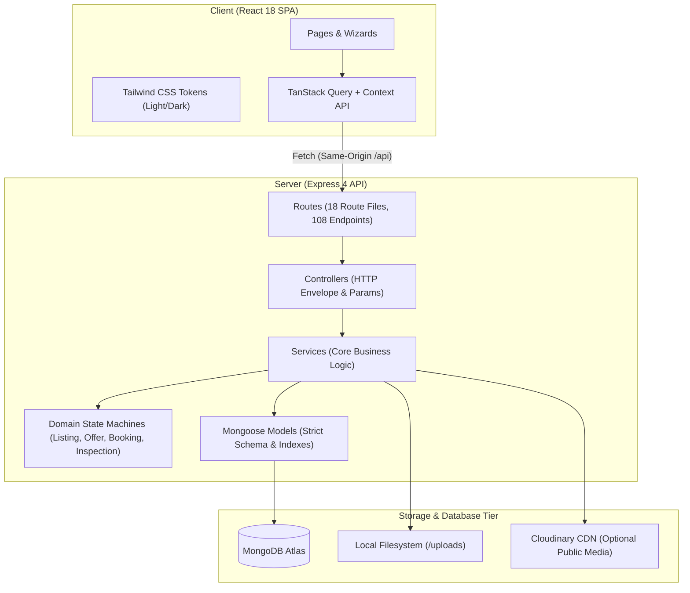

# Roam — System Architecture & Design

This document details the software architecture, design patterns, data models, state machines, and security boundary enforcement in Roam.

---

## 1. System Overview

Roam is built as a clean, decoupled monorepo structured into two primary tiers:
- **Client (`/client`)**: React 18 single-page application built with Vite, Tailwind CSS (driven by semantic CSS design tokens), React Router v6, TanStack Query v5, and Lucide Icons.
- **Server (`/server`)**: Node.js 20 Express RESTful API backed by MongoDB Atlas via Mongoose ODM, Zod validation, JWT authentication in HTTP-only cookies, Helmet security headers, rate limiting, and Multer media handling.



---

## 2. Server Architecture Rules

Roam follows a strict 4-layer separation of concerns:
1. **Routes (`src/routes/`)**: Mount HTTP paths, bind rate limiters, upload middleware, and authenticate/authorize requests via guards (`requireAuth`, `requireCapability`, `requireOwnership`, `requireAdmin`).
2. **Controllers (`src/controllers/`)**: Parse request inputs, invoke service methods, and return standard JSON response envelopes. Controllers contain zero business logic.
3. **Services (`src/services/`)**: Implement all business rules, database queries, notifications, state machine invocations, and calculations (pricing, money conversions).
4. **Models (`src/models/`)**: Mongoose schemas enforcing typed fields, validation, indexes, and custom JSON serialization methods (`toPublicObject()`, `toOwnerObject()`).

### Standard Response Envelope
All API responses strictly adhere to uniform envelopes:
- **Success (200 / 201)**:
  ```json
  {
    "success": true,
    "data": { ... }
  }
  ```
- **Error (4xx / 5xx)**:
  ```json
  {
    "success": false,
    "error": {
      "code": "VALIDATION_ERROR",
      "message": "Validation failed",
      "fields": {
        "askingPrice": "Price must be a positive integer"
      }
    }
  }
  ```

---

## 3. Explicit State Machines

All entity status lifecycles are governed by explicit domain state machine modules that reject illegal transitions with typed `ConflictError` (HTTP 409, code `INVALID_STATUS_TRANSITION`):

### Listing State Machine (`listingStateMachine.js`)
- **Moderation Transitions**: `draft` → `pending_review` → `approved` | `rejected`.
- **Re-review Triggers**: Editing key vehicle attributes (brand, model, manufacturing year, accident history) or listing description on an approved listing transitions it back to `pending_review`.
- **Sale Status Transitions**: `inactive` → `active` ↔ `reserved` → `sold`.
- **Rental Status Transitions**: `inactive` ↔ `active`.

### Offer State Machine (`offerStateMachine.js`)
- **Buyer & Seller Transitions**: `pending` → `countered` ↔ `countered` → `accepted` | `rejected` | `withdrawn` | `expired`.
- **Automatic Invalidation**: When an offer is accepted, competing pending or countered offers for the same listing are atomically set to `expired` with notification dispatches.

### Booking State Machine (`bookingStateMachine.js`)
- **Rental Lifecycle**: `pending` → `confirmed` → `active` (Handover) → `completed` (Return) | `cancelled` | `rejected`.
- **Modification Workflow**: `confirmed` → `modification_requested` → `confirmed` (approved) or previous dates preserved (rejected).

### Inspection State Machine (`inspectionStateMachine.js`)
- **Inspection Lifecycle**: `pending` → `confirmed` → `completed` | `cancelled` | `rejected`.

---

## 4. Polymorphic Ownership Model

Both individual users and commercial dealerships can list, manage, sell, or rent vehicles. To prevent code duplication or schema divergence, vehicles and listings employ polymorphic ownership references:
```javascript
ownerRef: {
  type: 'user' | 'dealer',
  id: mongoose.Schema.Types.ObjectId
}
```
- Server-side derivation: `ownerRef.type` is derived strictly on the server from authenticated user capabilities (`user.capabilities.includes('dealer') ? 'dealer' : 'user'`) and is stripped from incoming request payloads.
- Generic Guard Middleware: `requireOwnership(Model, paramName)` evaluates polymorphic ownership transparently, permitting either the vehicle/listing owner, the verified dealership owner, or a platform administrator.

---

## 5. Storage Abstraction Layer

Roam defines an abstract `StorageProvider` interface (`src/services/storage/storage.interface.js`):
- `saveFile(buffer, filename, subfolder)`
- `deleteFile(relativePath)`
- `getFilePath(relativePath)`

### Implementations:
1. **`LocalStorageProvider` (`localStorage.service.js`)**: Default for development and private documents. Stores files on local disk under `uploads/images` and `uploads/documents`.
2. **`CloudinaryStorageProvider` (`cloudinary.service.js`)**: Active when `STORAGE_PROVIDER=cloudinary`. Uploads public vehicle photos and dealership logos to Cloudinary CDN while routing sensitive legal documents to secure local authenticated disk streaming.

### Privacy Partitioning:
- **Public Images**: Uploaded to `uploads/images/` and served statically via `/uploads/images` or Cloudinary CDN.
- **Private Documents**: Uploaded to `uploads/documents/`. Never exposed via public static middleware. Served exclusively through authenticated streaming endpoints (`/api/vehicles/:id/documents/:docId/download` and `/api/dealers/:id/documents/:docId/download`).
